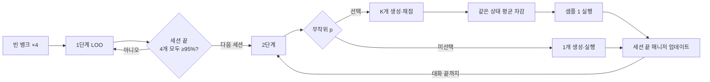

# CoverMem — Session-Gated Branch GRPO

기존 GRPO를 진행하다가 **세션 끝의 네 경로 뱅크가 모두 95% 이상이면, 다음 세션부터 같은 상태의 행동 후보를 비교하는 GRPO로 전환**하는 세 번째 실험이다. 전환은 대화별로 한 번만 일어나며, 다음 대화는 다시 1단계에서 시작한다.

**기본값: G=4, K=4, p=1/4.** 2단계에서는 매 경로·턴에 독립적으로 분기 여부를 추첨한다. 선택된 상태는 K개 출력을 학습하고, 나머지 상태는 한 번 생성해 뱅크만 진행한다. 학습 가능한 LoRA는 매니저 하나이며 별도 선택기 LoRA는 없다. 기존 [선택기 A/B 저장소](https://github.com/jiho-98/covermem-selector-grpo)의 K=10 실험과 별개다.

**A100 40GB ×16 서버용이지만 실험당 GPU 1장·프로세스 1개다.** DDP/FSDP/공유 prefix cache를 구현하지 않았다. CPU 검증은 통과했으나 실제 4B 모델의 GPU smoke·학습·평가는 아직 수행하지 않았다. 각 실행 큐는 GPU smoke를 먼저 검사한다.



2단계 보상은 **해당 훈련 대화의 전체 QG 질문**을 충분 근거 집합 기준으로 중복 제거한 뒤 `Score(교체/추가/유지 후) − Score(전)`으로 계산한다. Score는 `0.7 × 근거 커버리지 + 0.3 × 근거 재현율`이다. 미래 질문 라벨은 CPU 채점에만 사용하며 모델 입력에는 제공하지 않는다. 현재/미래 시간 가중치는 없다.

## 문서

- **[AI 에이전트용 통합 인계서: A/B·세 번째 실험](docs/AI_AGENT_HANDOFF_KO.md)** — 실행 담당 에이전트는 루트 [AGENTS.md](AGENTS.md)부터 읽는다.
- **[Google Drive 다운로드·분할 ZIP 복원](docs/DOWNLOAD_AND_RESTORE_KO.md)** — 최신 Git 코드에 어댑터·데이터만 가져오는 절차.
- **[서버 설치·실행·확인·재개 안내](docs/SERVER_RUNBOOK_KO.md)**
- **[박사님께 전달할 메시지](docs/HANDOFF_MESSAGE_KO.md)**
- [방법, 문서의 모호한 부분에 대한 결정, 비교 조건](docs/METHOD_AND_DECISIONS_KO.md)
- [CPU 검증 범위와 미검증 항목](validation/VALIDATION_KO.md)
- [사용자가 제공한 원문 제안](provenance/USER_PROPOSAL_20261024.txt) — 역사적 실험/시뮬 수치를 이 코드의 결과로 해석하지 않는다.

## 실행할 조건

| config | 학습 | 용도 |
|---|---|---|
| `branch_p025.json` | K=4, p=0.25, 95% 이후 local 분기 | 기본 실험 |
| `vanilla_matched.json` | 같은 전환/액션 제한/세션 정규화, 계속 LOO | 주 비교 기준선 |
| `vanilla_original.json` | 원래 5액션/재시도/고정 scale LOO, 추가 std 없음 | 원래 GRPO 방식의 같은 엔진 기준선 |
| `branch_p050.json` | K=4, p=0.5 | 추가 비용 대비 효과, 선택 사항 |
| `branch_p100.json` | K=4, p=1 | 매 턴 분기, 선택 사항 |

액션은 사용자 확인에 따라 1단계 ADD/SKIP/DELETE/REPLACE/UPDATE, 2단계 ADD/SKIP/REPLACE다. UPDATE로 묶인 항목은 분해하지 않으며 교체 시 항목 전체의 source turn이 빠진다. 모델은 매니저의 전체 행동 JSON을 생성하고 전체 응답 토큰을 학습한다.

## 설치 요약

GitHub에는 코드/설정/문서만 있다. `CoverMem_branch_GRPO_full.zip`에는 같은 코드와 입력 데이터·토크나이저·SFT 어댑터가 있다. 베이스 모델은 다운로드한다. 새 저장소와 새 ZIP을 사용하며 기존 A/B 출력 폴더를 재사용하지 않는다.

```bash
git clone https://github.com/jiho-98/covermem-branch-grpo.git
cd covermem-branch-grpo
conda env create -f environment.yml
conda activate covermem-branch
python3.10 scripts/import_assets.py --archive /path/to/CoverMem_branch_GRPO_full.zip
bash scripts/setup_env.sh
bash scripts/download_model.sh
bash scripts/check_cpu.sh configs/branch_p025.json
bash scripts/preflight.sh configs/branch_p025.json
```

이미 Python 3.10이 있으면 conda 단계는 생략한다. 설치는 `.venv`에 이루어지며 torch2.11.0/Transformers5.8.0/PEFT0.19.1을 고정한다. 기본 CUDA wheel은 cu130이고 서버 드라이버 호환성이 필요하다. 상세 절차·오프라인 모델 준비·Slurm 사용은 서버 안내를 따른다.

사용 권한을 확보한 GPU 번호를 사용하여 별도 터미널/tmux 창에서 실행한다:

```bash
CUDA_VISIBLE_DEVICES=0 bash scripts/run.sh configs/branch_p025.json orchestration/branch_p025
CUDA_VISIBLE_DEVICES=1 bash scripts/run.sh configs/vanilla_matched.json orchestration/vanilla_matched
CUDA_VISIBLE_DEVICES=2 bash scripts/run.sh configs/vanilla_original.json orchestration/vanilla_original
```

각 큐는 **GPU smoke → 학습 → 공식 근거 평가 → CPU 분석**을 자동으로 이어간다. Slurm에서는 스케줄러 GPU mask를 유지하고 한 실험에 한 장만 노출한다. 16프로세스 `torchrun`을 사용하지 않는다.

## 진행과 결과

```bash
.venv/bin/python scripts/queue.py status --root orchestration/branch_p025
tail -F orchestration/branch_p025/logs/branch_p025_train.log

# 완료/진행 중 결과를 읽는 CPU 비교 분석
.venv/bin/python -m cmbranch.analyze \
  --run runs/branch_v1/branch_p025 --run runs/branch_v1/vanilla_matched \
  --run runs/branch_v1/vanilla_original --report analysis/comparison.json
```

출력은 `runs/branch_v1/<config이름>/`이다. `TRAIN_COMPLETE.json`, `evaluation/EVAL_COMPLETE.json`, `ANALYSIS_COMPLETE.json`, 큐의 `ALL_COMPLETE.json`까지 확인한다. 평가 지표는 held-out 5대화/729문항의 근거 커버리지·재현율·적중률이며 QA 정답률은 아니다.

분석에는 95% 미만에서 근거/비근거 턴 ADD율, 경로별 95% 도달 시점·간격, 단계별 생성/학습 출력 및 토큰 수, 수집/업데이트 시간, 평가 REPLACE의 근거 상실/확보 event 수가 포함된다. K=4,p=1/4의 **기대 학습 출력 수**가 기존과 같다는 사실은 실제 시간/FLOPs가 같다는 뜻은 아니다.

## 코드 구성

| 경로 | 기능 |
|---|---|
| `cmbranch/train.py`, `rollout.py` | 대화별 단계 상태, 4경로 수집, 세션당 업데이트 |
| `cmbranch/branching.py` | 중복 제거, full-action K분기, 순이익, local baseline, 세션 std |
| `cmbranch/monitoring.py`, `analyze.py` | 95% 전환 및 ADD 감시·비용 집계 |
| `cmbranch/backend.py` | 하나의 학습 매니저와 고정 SFT reference, 생성 logprob/PPO loss |
| `cmbranch/action_credit.py`, `active_policy.py` | 보존한 원래 LOO credit 및 RAW executor |
| `cmbranch/checkpoint.py`, `evaluate.py` | phase/RNG/뱅크/optimizer 재개 및 한 경로 greedy 평가 |
| `scripts/`, `supervision/`, `tests/` | 설치·큐·지속 supervisor·CPU 검증 |

실행 중 source/config를 바꾸거나 Git pull로 교체하지 않는다. 변경된 연구 조건은 새 checkout/출력 폴더와 fingerprint로 분리한다. 저장소는 Public이며 HTTPS clone에 GitHub 인증이 필요 없다. 전체 ZIP만으로도 실행할 수 있지만 최신 문서는 GitHub에서 읽는다.
